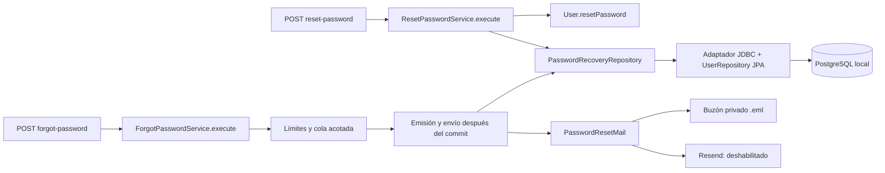

# Recuperación de contraseña — implementación local

El flujo reside en Spring Boot y sirve a clientes y comerciantes. No necesita Angular ni Next.js. No se enviaron correos reales ni se ejecutaron migraciones en bases desplegadas. La publicación se prepara en una rama de funcionalidad, sin desplegar.

El inventario completo de archivos está en [ARCHIVOS.md](ARCHIVOS.md).

## Inspección y decisiones

El módulo `identity` separa dominio, aplicación, adaptadores de persistencia/seguridad y web. `UserRepository` es un puerto; su adaptador usa Spring Data JPA y `UserPersistenceMapper`. `AuthController` mantiene registro, login y renovación del JWT de acceso. No existía un servicio de correo ni un token de refresh separado. Se reutilizan el bean `PasswordEncoder` con BCrypt, Bean Validation, `ApiError`, `GlobalExceptionHandler` y `RateLimits`.

La última migración encontrada fue **V26**. Se añadió **V27__add_password_recovery.sql**, sin editar migraciones anteriores. La aplicación usa Spring Boot 4.1.1 y Java 21; no se añadieron dependencias.

## Arquitectura



Cada caso de uso tiene un servicio con una única entrada pública `execute(command)`, siguiendo las convenciones de `identity`. El controlador transforma los DTO HTTP en `ForgotPasswordCommand` y `ResetPasswordCommand`.

`ForgotPasswordService.execute(ForgotPasswordCommand)` normaliza el correo, aplica los límites y encola la emisión para cualquier dirección válida, exista o no. La emisión es un detalle privado del mismo caso de uso: genera el token, guarda su hash y envía el correo después del commit. La respuesta HTTP no espera búsquedas de cuenta ni llamadas al proveedor. La cola mantiene un trabajador y capacidad 100; al saturarse responde 429. Los fallos del trabajador generan únicamente un mensaje fijo, sin excepción, destinatario, cuerpo ni token.

`ResetPasswordService.execute(ResetPasswordCommand)` valida y consume el token, codifica la contraseña con el `PasswordEncoder` existente y la cambia mediante `User.resetPassword`, dentro de la misma transacción. La utilidad técnica `PasswordResetTokens` está en `infrastructure/security`: genera 32 bytes con `SecureRandom`, codifica Base64 URL sin padding y calcula SHA-256. El token sigue expirando a los 15 minutos.

El adaptador de correo tiene modos `disabled` (por defecto), `local` y `resend`. El modo local exige perfil `local` o `test` y escribe archivos `.eml` con permiso 0600 dentro de un directorio 0700, ignorado por Git. Esos archivos contienen el mensaje con su token: deben tratarse como correo privado y eliminarse después de la prueba. El token nunca se devuelve por HTTP ni se escribe en logs.

## Persistencia y concurrencia

V27 agrega:

- `users.credentials_version BIGINT NOT NULL DEFAULT 0`, con restricción no negativa.
- `password_reset_tokens`: `user_id` como PK/FK con borrado en cascada, `token_hash` único de 64 caracteres hexadecimales y `expires_at TIMESTAMPTZ`.

Se conserva una sola fila por usuario; una nueva solicitud reemplaza el hash anterior. No se reescriben usuarios ni contraseñas existentes. La validación SQL comprueba la preservación de todos los campos de usuarios previos a V27.

Emisión y restablecimiento bloquean primero la fila de usuario con `SELECT ... FOR UPDATE`. En reset, el `DELETE` condicional exige hash coincidente y `expires_at > now` y debe afectar exactamente una fila. Su consumo, cambio de contraseña e incremento de versión comparten transacción. Si falla la actualización, el token queda disponible por rollback. Dos resets simultáneos con el mismo token tienen un solo ganador; las solicitudes de emisión se serializan por usuario. El correo se entrega después del commit, fuera del bloqueo.

`password_encoded` y `credentials_version` no se actualizan mediante merges JPA genéricos. El adaptador de recuperación actualiza solo esas credenciales con comprobación de versión. Así, un guardado de perfil con una copia antigua no puede restaurar la contraseña ni deshacer la revocación.

## Contratos HTTP

Ambos endpoints son públicos y reciben JSON. Las respuestas exitosas incluyen `Cache-Control: no-store`.

| Endpoint | Cuerpo | Respuesta |
|---|---|---|
| `POST /api/v1/auth/forgot-password` | `{"email":"usuario@example.test"}` | `202` con mensaje genérico |
| `POST /api/v1/auth/reset-password` | `{"token":"<token del correo>","newPassword":"<contraseña nueva>"}` | `204`, sin cuerpo |

Forgot responde siempre: `Si el correo corresponde a una cuenta habilitada, recibirás instrucciones para restablecer la contraseña.` La respuesta es idéntica para correos existentes, inexistentes, usuarios deshabilitados y límites por cuenta alcanzados. Los límites globales y por IP responden 429 sin consultar la existencia de la cuenta.

| Caso | Estado / código |
|---|---|
| Email inválido, token con formato inválido, contraseña fuera de longitud | `400 VALIDATION_ERROR` |
| Contraseña con más de 72 bytes UTF-8 | `400 INVALID_ARGUMENT` |
| Token bien formado inexistente, vencido, reemplazado o consumido; cuenta deshabilitada | `422 INVALID_PASSWORD_RESET_TOKEN` |
| Límite global/IP o cola llena | `429 RATE_LIMIT_EXCEEDED`, con `Retry-After` |
| JWT anterior al reset en ruta protegida o `/refresh` | `401` |

El correo admite hasta 254 caracteres. La contraseña nueva exige al menos 8 caracteres y un máximo de 72 bytes UTF-8, compatible con el límite de BCrypt. El login conserva su contrato y sigue verificando contraseñas existentes.

## Destino del enlace (Marketplace vs Merchant) y Cuentas con Múltiples Roles

Para dirigir al usuario a la interfaz correcta (`frontend-marketplace` o `frontend-merchant`), el backend resuelve el destino combinando datos confiables del backend (roles autoritativos en base de datos) y validación estricta de hosts autorizados:

1. **Datos autoritativos del backend (Roles):**
   - Cuentas con solo rol `CUSTOMER`: El enlace siempre se genera hacia `PASSWORD_RESET_URL_BASE` (`/reset-password` de Marketplace). Aunque una petición intente falsificar un origen de Merchant, una cuenta puramente cliente no es dirigida a la plataforma operativa.
   - Cuentas con rol `MERCHANT` o `ADMIN`: Por defecto son dirigidas a `MERCHANT_PASSWORD_RESET_URL_BASE` (`/reset-password` de Merchant).
2. **Cuentas con múltiples roles (`CUSTOMER` + `MERCHANT` o `CUSTOMER` + `ADMIN`):**
   - En JaldiShop, todo comerciante posee también rol `CUSTOMER` (creado contextualmente durante el registro).
   - Si la solicitud incluye un header `Origin` verificado dentro de la lista explícita de `app.password-reset.mail.allowed-hosts`, se respeta el contexto desde el cual el usuario solicitó la recuperación:
     - Solicitud desde Marketplace (`jaldishop.net` o `localhost:3000`): Genera enlace a la pantalla de recuperación de Marketplace.
     - Solicitud desde Merchant Portal (`negocios-jaldishop.pages.dev` o `localhost:4200`): Genera enlace a la pantalla de recuperación de Merchant.
   - Si no se provee `Origin` o el host no está autorizado, se prioriza el perfil de mayor privilegio (`MERCHANT`/`ADMIN`), dirigiéndolo a `frontend-merchant`.
   - Dado que el backend maneja una única contraseña por cuenta en la tabla `users`, el restablecimiento en cualquiera de las dos aplicaciones actualiza las credenciales e incrementa `credentials_version` de forma global e instantánea.
3. **Compatibilidad con Render:**
   - La propiedad `app.password-reset.mail.merchant-reset-url-base=${MERCHANT_PASSWORD_RESET_URL_BASE:}` es opcional en despliegues existentes. Si no está definida en Render, el sistema utiliza de manera segura `PASSWORD_RESET_URL_BASE` sin interrumpir el arranque del servicio.

## Límites de solicitudes

Se reutiliza el mecanismo de ventanas fijas y capacidad acotada existente:

| Política | Límite por defecto | Resultado al exceder |
|---|---|---|
| `forgot-password-account` | 3 por correo normalizado / 15 minutos | `202`, sin encolar trabajo adicional |
| `forgot-password-ip` | 10 / IP / 15 minutos | `429` |
| `reset-password-ip` | 20 / IP / 15 minutos | `429` |
| `forgot-password-global` | 100 / minuto | `429` |
| `reset-password-global` | 100 / minuto | `429` |

Los contadores por correo usan su hash y también se aplican a direcciones inexistentes. Las propiedades `app.security.rate-limit.<política>.limit` y `.window-seconds` permiten configurar estos valores externamente. Se mantiene la resolución de IP del proyecto: no confía en `X-Forwarded-For` arbitrario. Cuando la verificación de ingreso de Render está desactivada, las políticas por IP siguen desactivadas allí; los límites por cuenta y globales permanecen activos. No se modificó Render ni esa configuración.

Los contadores y la cola son locales al proceso. Reiniciar los borra; varias instancias no comparten límites. Antes de escalar a varias instancias habría que compartir los contadores y usar una cola durable. Los bloqueos y el consumo del token sí están coordinados por PostgreSQL.

## Revocación JWT

Los nuevos JWT llevan claim `cv`, correspondiente a `users.credentials_version` al autenticar. Cada reset incrementa esa versión. `JwtAuthenticationFilter` compara la versión firmada con la versión actual en base de datos antes de autenticar; sigue consultando estado y roles actuales.

`RefreshTokenService` recibe también la versión del principal y vuelve a comprobarla, además del estado activo, para cubrir la carrera entre el filtro y el servicio. Si reset ocurre después de la lectura del servicio, el token emitido conserva la versión antigua y será rechazado en la siguiente autenticación. Login y registro de comerciantes emiten la versión de su propia lectura de usuario, sin actualizarla desde otro snapshot.

Los JWT existentes sin `cv` se interpretan como versión 0: siguen funcionando hasta el primer reset de su usuario. No se depende de segundos ni fechas `iat`, por lo que dos operaciones en el mismo segundo quedan correctamente separadas.

WebSocket comprueba la misma versión en CONNECT, SUBSCRIBE y antes de cada entrega a una suscripción existente. Una sesión revocada deja de recibir datos aunque el transporte continúe abierto.

## Prueba manual local / Postman

Importar [la colección](../../qa/password-recovery/password-recovery.postman_collection.json). Su script impide usar URLs ajenas a `http://127.0.0.1:<puerto>` o `http://localhost:<puerto>`.

1. Arrancar el backend **solo contra una base local** con `SPRING_PROFILES_ACTIVE=local`, `PASSWORD_RESET_MAIL_MODE=local` y `PASSWORD_RESET_REAL_DELIVERY_ENABLED=false`. Revisar la URL local antes del arranque, porque la aplicación aplica Flyway al iniciar. No usar configuraciones de bases desplegadas.
2. Elegir una cuenta local de prueba de cliente o comerciante y completar `email`, `oldPassword` y `newPassword` (distintas) en la colección. `baseUrl` apunta a loopback por defecto.
3. Ejecutar requests 01–03. Esperar a que aparezca el `.eml` de ese destinatario en `backend/.local/password-reset-mail/` si se arrancó desde `backend/`; la ruta es relativa al directorio de ejecución.
4. Abrir el archivo en un editor privado y copiar su token a `resetToken`. No imprimirlo en terminal ni consola de Postman. Continuar con 04–10.
5. Se comprueban reset, rechazo de JWT/contraseña anterior, login con contraseña nueva, refresh con JWT nuevo y rechazo de reutilización/token inexistente. Repetir con la otra clase de cuenta.
6. Para expiración, solicitar otro correo, esperar 15 minutos y ejecutar reset: debe responder el mismo 422 genérico. Las pruebas automatizadas controlan el reloj y no requieren esa espera.
7. Eliminar los `.eml` y las variables sensibles después de la prueba. No exportar la colección con valores reales.

## Pruebas automatizadas y evidencia

Los resultados exactos de la ejecución final se registran en [CI.md](CI.md). Las pruebas PostgreSQL/JDBC exigen `TestPostgresConfig`: base exclusiva `jaldishop_integration_test`, host loopback y puerto explícito; rechazan URLs remotas antes de Flyway. No se cambiaron pruebas ajenas para omitir fallos.

Para ejecutar la integración en un entorno que permita sockets, preparar una base local descartable con ese nombre y configurar únicamente sus credenciales en el proceso:

```bash
# Desde backend/, con DB_URL, DB_USERNAME y DB_PASSWORD de la base de pruebas local.
# JWT_SECRET debe ser una clave exclusivamente de pruebas de al menos 32 bytes.
./mvnw -Dspring.config.import= -Dtest=PasswordRecoveryPostgresIntegrationTest test
./mvnw -Dspring.config.import= verify
```

La integración cubre cliente y comerciante, login nuevo/anterior, hash almacenado, revocación de refresh, vencimiento exacto, inexistencia, reutilización, reemplazo, resets concurrentes, emisiones concurrentes, rollback por fallo de actualización y guardado de perfil obsoleto. En este entorno, JDBC y los sockets reales están bloqueados; estos escenarios no se consideran certificados solo porque compilen.

La prueba SQL adicional crea su propio cluster temporal y usa PostgreSQL monousuario, sin puertos, URLs externas ni `.env`:

```bash
PASSWORD_RECOVERY_TEST_PG_BIN=/ruta/postgresql/bin python qa/password-recovery/verify-postgres.py
```

Las variables opcionales `PASSWORD_RECOVERY_TEST_PG_SHARE` y `PASSWORD_RECOVERY_TEST_PG_LIB` permiten usar una instalación portable con rutas de recursos y bibliotecas explícitas. Esta prueba valida SQL, restricciones y rollback, pero no sustituye la integración Spring/JPA ni prueba carreras entre conexiones.

## Configuración pendiente para correo real

La entrega real permanece deshabilitada. Se preparó un adaptador HTTPS para Resend reutilizando `RestClient`, sin dependencias nuevas. Usa el endpoint fijo del proveedor, timeout de conexión/lectura de 5 segundos, sin redirects configurados, y descarta los cuerpos de error para no registrar tokens. El payload saliente oculta su contenido en `toString`, también cuando RestClient registra el cuerpo a nivel DEBUG.

Para una fase futura se requiere cuenta del proveedor, dominio/remitente verificados y clave de API externa con permisos de envío. Las variables son:

| Variable | Valor actual / propósito |
|---|---|
| `PASSWORD_RESET_MAIL_MODE` | `disabled` por defecto; `local` para desarrollo; `resend` para el proveedor preparado |
| `PASSWORD_RESET_REAL_DELIVERY_ENABLED` | `false`; el modo proveedor exige activación explícita |
| `PASSWORD_RESET_MAIL_FROM` | Sin valor por defecto; remitente verificado |
| `PASSWORD_RESET_MAIL_API_KEY` | Sin valor por defecto; secreto externo |
| `PASSWORD_RESET_MAIL_LOCAL_DIRECTORY` | `.local/password-reset-mail` |

No se configuraron credenciales ni se probó entrega real. Si falla el envío después del commit, la solicitud sigue con respuesta genérica y el usuario puede volver a solicitar el flujo respetando sus límites. La cola no persiste ni reintenta tras reinicios.

Referencias de diseño: [OWASP Forgot Password](https://cheatsheetseries.owasp.org/cheatsheets/Forgot_Password_Cheat_Sheet.html) y [contrato de envío de Resend](https://resend.com/docs/api-reference/emails/send-email).
