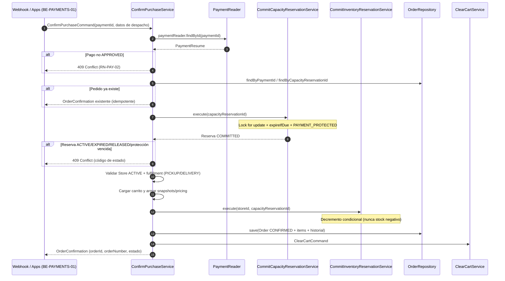

# Confirmación Transaccional de Compra (ConfirmPurchase)

La **Confirmación Transaccional de Compra** es el caso de uso que convierte una compra con **pago aprobado** en una operación confirmada de JaldiShop: compromete la reserva de capacidad (`COMMITTED`), descuenta inventario de forma atómica, crea el `Order` en estado `CONFIRMED` (con sus ítems e historial) y vacía el carrito — **todo dentro de una única transacción ACID**.

> 📌 **Regla central BE-20:** solo una operación con **pago `APPROVED`** y **reserva `PAYMENT_PROTECTED` vigente** puede generar un Pedido. La confirmación es **idempotente**: reintentos de webhook o duplicados concurrentes nunca crean pedidos duplicados.

---

## Participantes

| Módulo | Rol en la confirmación |
|---|---|
| `Payment` | Lectura del pago (read-only) y verificación de estado `APPROVED` |
| `Capacity` | `CommitCapacityReservationService`: valida `PAYMENT_PROTECTED` vigente y transiciona a `COMMITTED` |
| `Inventory` | `CommitInventoryReservationService`: descuenta stock condicionalmente y compromete holds (`COMMITTED`) |
| `Ordering` | Crea `Order` (CONFIRMED) + `OrderItems` + historial de estado |
| `Cart` | Vacía el carrito del cliente al finalizar |
| `Catalog`/`Store` | Precios e ítems (assembler de snapshot), tienda `ACTIVE`, tarifa de entrega e IGV |

---

## Flujo

## Transacción y Atomicidad

* `ConfirmPurchaseService` es `@Transactional`: si cualquier paso falla (reserva inválida, stock insuficiente, error de persistencia), **nada se confirma** y la transacción hace *rollback* completo. No existen efectos parciales (p.ej. inventario descontado sin pedido).
* `CommitCapacityReservationService` y `CommitInventoryReservationService` son servicios `@Transactional` internos reutilizables, pensados también para otros orquestadores.

### Validación-de-todo / Aplicación-de-todo (Inventario)

1. **VALIDATE ALL:** se bloquean los `inventories` de las variantes en orden canónico (`variant_id ASC`) y se verifica que cada una tenga stock suficiente con el decremento atómico:
   `UPDATE inventories SET quantity = quantity - ? WHERE variant_id = ? AND quantity - ? - <otherActiveReserved> >= 0`.
   Si **alguna** variante no cumple → `INSUFFICIENT_STOCK` y rollback (no queda ningún decremento aplicado).
2. **ACT ALL:** recién cuando todas las variantes validaron, los holds de inventario se marcan `COMMITTED`.

> La guarda `otherActiveReserved` excluye el hold de la propia reserva (conteo *lazy* sobre holds `ACTIVE` no vencidos), impidiendo la doble contabilización del cupo propio y el sobreventa frente a otros holds.

---

## Idempotencia

La confirmación es idempotente por **tres mecanismos**:

1. **Consulta previa:** `findByPaymentId` y `findByCapacityReservationId` retornan el `Order` existente sin reprocesar (sin re-commit de capacidad/inventario, sin re-save).
2. **Resolución de carrera por lock:** la serialización real la otorga el **lock pesimista** (`FOR UPDATE`) de la fila `capacity_reservations`. El primer request completa reserva→inventario→pedido; el concurrente, al despertar, re-lee el pedido del ganador (`findByCapacityReservationId`) y lo devuelve.
3. **Backstop de base de datos:** constraints `UNIQUE (payment_id)`, `UNIQUE (capacity_reservation_id)` y `UNIQUE (order_number)` en `orders` impiden duplicados ante cualquier condición inesperada.

> ⚠️ **IDEMPOTENCIA DEMOSTRADA:** el test de integración `ConfirmPurchaseConcurrencyIntegrationTest` ejecuta N requests concurrentes sobre la misma reserva/pago contra PostgreSQL real y verifica que **exactamente una** fila de `orders` y **una** reserva `COMMITTED` resultan de la carrera.

---

## Errores (contrato `ApiError`)

| Código | HTTP | Condición |
|---|---|---|
| `RN-PAY-02` | 409 | El pago no está `APPROVED` |
| `RESERVATION_NOT_PAYMENT_PROTECTED` | 409 | La reserva está `ACTIVE` (nunca se promueve en confirmación) |
| `RESERVATION_EXPIRED` | 409 | La reserva expiró (TTL 10 min) |
| `RESERVATION_RELEASED` | 409 | La reserva fue liberada (checkout descartado) |
| `RESERVATION_PROTECTION_EXPIRED` | 409 | La ventana de protección de pago venció | 
| `INSUFFICIENT_STOCK` | 409 | Stock insuficiente para una o más variantes |
| `STORE_INACTIVE` | 409 | La tienda no está `ACTIVE` |
| `CART_EMPTY` | 409 | El carrito no existe o está vacío |
| `VARIANT_STORE_MISMATCH` / `VARIANT_INACTIVE` / `PRODUCT_INACTIVE` | 409 | Ítems no válidos al armar el snapshot |
| `DELIVERY_NOT_AVAILABLE` / `PICKUP_NOT_AVAILABLE` / `DELIVERY_ADDRESS_REQUIRED` | 409 | Fulfillment inválido para la tienda |
| `RESOURCE_NOT_FOUND` | 404 | Pago o reserva de capacidad inexistente |

---

## Pedido Generado

* `order_number` = `JAL-{año}-{seq:06d}` (secuencia `seq_order_number`).
* `Order` en estado `CONFIRMED`, asociado a `payment_id`, `capacity_reservation_id`, `store_id` y `user_id`.
* `OrderItems` con variante, producto/presentación, cantidad, precio unitario y subtotal.
* `OrderStatusHistory` con el evento inicial `CONFIRMED`.
* Moneda `PEN`; montos: subtotal productos, descuento, tarifa de entrega, IGV incluido y total.

> ⚠️ **Fuera de alcance:** llamar a Mercado Pago, procesar tarjeta, UI o refunds automáticos. La compensación/reconciliación se trata separadamente de la confirmación.