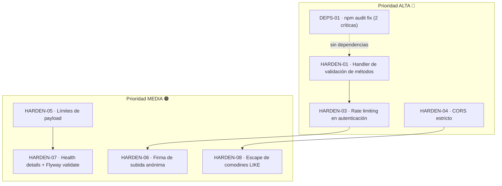

# Backlog de Seguridad y Hardening (Serie HARDEN)

### JaldiShop — Tarjetas de Prioridad ALTA y MEDIA para el Plan de Seguridad

---

`📍 Docs` > `06-Scrum` > **Backlog HARDEN (Seguridad)**
[⬅ Sprint 04](./sprint-04.md) | [🏠 Índice General](../../README.md) | [Contrato de Errores ➡](../04-diseno/contrato-api-errores.md)

---

## 1. Propósito y Contexto

> 📌 **Nota:** Backlog derivado de la **auditoría de código del backend y frontends (22-10-2026)**. Consolidan las tarjetas de **prioridad ALTA y MEDIA** para endurecer validaciones, límites de entrada, control de acceso y dependencias, manteniendo el cumplimiento de los estándares del proyecto (arquitectura modular, contrato `ApiError`, CI/CD y buenas prácticas OWASP).

Este documento es la **fuente de planificación** del ciclo de hardening: cada tarjeta define entregable, checklist, criterios de aceptación y archivos a tocar para poder ejecutarla en ramas/PR pequeños **sin interferir con las tarjetas de Katherine (`payment`, catálogo storefront) ni las de Mia (`ordering`, carrito)**.

> ⚠️ **Numeración:** `HARDEN-01` y `HARDEN-02` están consumidos (02 completado en PR #60). La numeración `HARDEN-03+` y `DEPS-01` es **propuesta de esta auditoría** y debe confirmarse contra el backlog externo del equipo antes de abrir ramas.

**Alcance de este documento:** tarjetas ALTA (🔴) y MEDIA (🟠). Las de prioridad BAJA se listan solo a modo de trazabilidad en la sección 7.

---

## 2. Orden de Ejecución y Dependencias

> 📌 **Recomendación:** un PR por tarjeta, en el orden ALTA → MEDIA. `HARDEN-01` es prerrequisito conceptual de `HARDEN-03` (los 429/400 deben salir con el mismo contrato `ApiError`).

---

## 3. Matriz de Prioridades

| ID | Tarjeta | Prioridad | Esfuerzo | Responsable | Archivos críticos |
|:---:|---|:---:|:---:|:---:|---|
| **HARDEN-01** | Handler global de validación de métodos | 🔴 ALTA | S | Josué | `shared/exception/GlobalExceptionHandler.java` 🔥 |
| **DEPS-01** | Remediar vulnerabilidades `npm audit` | 🔴 ALTA | S | Josué | `*/package-lock.json` 🔥 |
| **HARDEN-03** | Rate limiting y anti brute-force en auth | 🔴 ALTA | M | Josué | `identity/infrastructure/security/SecurityConfig.java` 🔥 |
| **HARDEN-04** | Endurecimiento de la política CORS | 🔴 ALTA | S | Josué | `identity/infrastructure/security/WebCorsConfiguration.java` 🔥 |
| **HARDEN-05** | Límites de payload y de paginación | 🟠 MEDIA | S | Josué | `application.properties` 🔥 |
| **HARDEN-06** | Firma de subida anónima (logo/banner) | 🟠 MEDIA | M | Josué | `media/web/controller/MediaController.java` |
| **HARDEN-07** | Detalles de health + validación Flyway | 🟠 MEDIA | S | Josué | `application.properties` 🔥 |
| **HARDEN-08** | Escape de comodines en búsquedas `LIKE` | 🟠 MEDIA | S | Josué | `store/.../StoreJpaRepository.java` |

> 🔥 = archivo compartido/caliente: anunciar en el PR antes de modificarlo.

---

## 4. Tarjetas Detalladas

### 📋 HARDEN-01 | Handler global de validación de métodos

**Responsable:** Josué · **Prioridad:** 🔴 ALTA · **Estado:** `PENDIENTE` · **Esfuerzo:** S
**Entregable:** Manejador de `HandlerMethodValidationException` (Spring 7) que traduzca violaciones de validación de *path/query* al contrato `400 VALIDATION_ERROR`, con tests negativos.

**Descripción:**
Con `@Validated` activo en 7 controllers (HARDEN-02), una violación de parámetro ya no llega al `MethodArgumentNotValidException` de bodies, sino al `HandlerMethodValidationException` de Spring 7, que **hoy no tiene handler**: cae en el manejo por defecto y responde `500` en lugar del `400 VALIDATION_ERROR` definido en el contrato de errores.

**Checklist:**
- [ ] Agregar `@ExceptionHandler(HandlerMethodValidationException.class)` en `GlobalExceptionHandler`
- [ ] Mapear cada violación (método, argumento, mensaje) al DTO `ApiError` del contrato
- [ ] Mantener `400` + código `VALIDATION_ERROR` y el `field`/`parameter` afectado
- [ ] Verificar que el mensaje no filtre clases internas ni stack trace
- [ ] Test unitario del manejador
- [ ] Test MockMvc sobre un endpoint con parámetro inválido (esperar `400`, no `500`)
- [ ] Actualizar `docs/04-diseno/contrato-api-errores.md` si cambia el shape

**Criterios de aceptación:** ninguna petición con parámetro inválido responde `500`; el 100% de los `VALIDATION_ERROR` (body, query y path) comparten forma de respuesta.
**Archivos:** `GlobalExceptionHandler.java` 🔥 · `contrato-api-errores.md` 🔥 · tests.

---

### 📋 DEPS-01 | Remediar vulnerabilidades de dependencias (`npm audit`)

**Responsable:** Josué · **Prioridad:** 🔴 ALTA · **Esfuerzo:** S · **Estado:** `PENDIENTE`
**Entregable:** `npm audit` sin vulnerabilidades *critical/high* en ambos frontends, con tests y build verificados.

**Descripción:**
Auditoría del 22-10-2026 (`npm audit --omit=dev`):

| Paquete | Vulns | Severidad |
|---|:---:|---|
| `frontend-marketplace` (`solid-js` → `seroval`) | 4 | **2 critical**, 1 high, 1 moderate |
| `frontend-merchant` (`fast-uri`, `source-map-js`) | 3 | 1 moderate, 2 high |

**Checklist:**
- [ ] `npm audit fix` en `frontend-marketplace` (sin `--force`)
- [ ] `npm audit fix` en `frontend-merchant`
- [ ] Verificar compatibilidad: `npm test` (100/100) + `npm run build` en marketplace
- [ ] Verificar `npm test` en merchant
- [ ] Si alguna corrección es *breaking*, evaluar upgrade menor manual y documentar la decisión
- [ ] Confirmar `npm audit --omit=dev` en verde (0 critical/high)

**Criterios de aceptación:** 0 vulnerabilidades *critical* y *high*; suites de ambos frontends en verde.
**Archivos:** `frontend-marketplace/package-lock.json` 🔥 · `frontend-merchant/package-lock.json` 🔥.
**⚠️ Nota:** los locks los pueden tocar otros PRs → rebase corto antes de mergear.

---

### 📋 HARDEN-03 | Rate limiting y protección anti brute-force

**Responsable:** Josué · **Prioridad:** 🔴 ALTA · **Esfuerzo:** M · **Estado:** `PENDIENTE`
**Entregable:** Límite de tasa aplicado a `/api/v1/auth/login`, `/api/v1/auth/register`, `/api/v1/auth/register/**` y `/api/v1/auth/refresh`, con respuesta `429` al contrato `ApiError` y tests.

**Descripción:**
Actualmente **no existe** rate limiting, bloqueo de intentos ni `loginAttempt` en el código (`grep RateLimit|Bucket4j|loginAttempt|accountLock` → 0 resultados). Con `POST /auth/login` en `permitAll`, un ataque de fuerza bruta no tiene fricción alguna.

**Checklist:**
- [ ] Elegir mecanismo acorde al monolito modular (p. ej. Bucket4j o filtro propio con `Caffeine`) y justificarlo en la doc
- [ ] Límite por IP y por identificador de usuario en `login`
- [ ] Límite por IP en `register`/`register/**` y `refresh`
- [ ] Respuesta `429` con código estándar del contrato (`RATE_LIMITED` o el definido) vía `GlobalExceptionHandler`
- [ ] No filtrar si el usuario existe (mensajes genéricos de auth)
- [ ] Cabecera estándar `Retry-After`
- [ ] Tests: superar el umbral → `429`; bajo el umbral → `200`
- [ ] Documentar variables de configuración (umbral, ventana) en `.env.template` y `README`

**Criterios de aceptación:** la fuerza bruta sobre `login` queda limitada por IP/usuario sin afectar el flujo legítimo; el límite es configurable por entorno.
**Archivos:** paquete nuevo en `identity/infrastructure/security/` · `SecurityConfig.java` 🔥 · `GlobalExceptionHandler.java` 🔥 · `pom.xml` 🔥.

---

### 📋 HARDEN-04 | Endurecimiento de la política CORS

**Responsable:** Josué · **Prioridad:** 🔴 ALTA · **Esfuerzo:** S · **Estado:** `PENDIENTE`
**Entregable:** Allowlist de orígenes estricta y testeada en `WebCorsConfiguration`.

**Descripción:**
Hoy se permite `https://*.vercel.app` y `https://*.pages.dev` (orígenes de **cualquier tercero**) junto a `allowCredentials(true)` y `allowedHeaders("*")`, lo que viola el principio de mínimo privilegio del propio documento de arquitectura.

**Checklist:**
- [ ] Reemplazar comodines de terceros por orígenes exactos propios (`jaldishop.net`, `www.jaldishop.net`, `negocios-jaldishop.pages.dev`, previews oficiales del proyecto)
- [ ] Mantener `http://localhost:*` solo detrás de una propiedad/flag de perfil `dev`
- [ ] Restringir `allowedHeaders` a los realmente usados (`Authorization`, `Content-Type`, `Idempotency-Key`)
- [ ] Revisar `allowedMethods` (¿se usa `DELETE`?)
- [ ] Verificar que el marketplace en Vercel y el panel en Cloudflare Pages sigan funcionando
- [ ] Test: origen no listado → sin cabeceras CORS
- [ ] Documentar la lista de orígenes permitidos en `docs/05-arquitectura/`

**Criterios de aceptación:** solo orígenes propios consumen la API con credenciales; los deploys reales (Vercel + Cloudflare Pages) no rompen.
**Archivos:** `WebCorsConfiguration.java` 🔥 · tests.

---

### 📋 HARDEN-05 | Límites de payload y de paginación

**Responsable:** Josué · **Prioridad:** 🟠 MEDIA · **Esfuerzo:** S · **Estado:** `PENDIENTE`
**Entregable:** Topes globales de tamaño de request/multipart y de paginación, con tests.

**Descripción:**
`application.properties` no define `spring.servlet.multipart.max-file-size` ni un techo global de cuerpo; HARDEN-02 puso `@Min/@Max` por endpoint, pero no existe un límite único que aplique a endpoints nuevos por defecto.

**Checklist:**
- [ ] `spring.servlet.multipart.max-file-size` / `max-request-size` explícitos
- [ ] Tamaño máximo de cuerpo JSON (Tomcat/`max-http-form-post-size`) documentado
- [ ] Límite superior global de paginación (`pageable.max-int` o equivalente) como red de seguridad para endpoints nuevos
- [ ] Test: payload que excede el límite → `413`/`400` con contrato `ApiError`
- [ ] Documentar límites en `docs/04-diseno/contrato-api-errores.md`

**Criterios de aceptación:** ningún endpoint acepta cuerpos ilimitados; los límites están documentados y probados.
**Archivos:** `application.properties` 🔥 · `GlobalExceptionHandler.java` 🔥 · tests.

---

### 📋 HARDEN-06 | Firma de subida anónima (logo/banner de tienda)

**Responsable:** Josué · **Prioridad:** 🟠 MEDIA · **Esfuerzo:** M · **Estado:** `PENDIENTE`
**Entregable:** `POST /api/v1/media/upload-signature` endurecido para el caso anónimo.

**Descripción:**
El endpoint está en `permitAll` y `MediaController` acepta `principal == null` para `STORE_LOGO`/`STORE_BANNER` (flujo de alta de tienda). Un tercero puede emitir firmas de subida a voluntad contra tu cuenta de Cloudinary.

**Checklist:**
- [ ] Evaluar: exigir sesión desde el primer paso **o** mantener anónimo solo con mitigaciones explícitas
- [ ] Rate limit específico para este endpoint (reutilizar `HARDEN-03`)
- [ ] Validar `targetType`/`storeId` contra estado real de la tienda (solo `DRAFT` en alta)
- [ ] Restringir tipos MIME/tamaños de imagen en la firma
- [ ] Test: sin sesión + targetType de producto → `403` (ya existe); añadir test de abuso de firma anónima
- [ ] Documentar el flujo en `docs/04-diseno/`

**Criterios de aceptación:** no es posible emitir firmas ilimitadas sin sesión válida; el alta de tienda legítima sigue funcionando.
**Archivos:** `MediaController.java` · `GenerateUploadSignatureService` · `SecurityConfig.java` 🔥.

---

### 📋 HARDEN-07 | Detalles de health y validación de migraciones

**Responsable:** Josué · **Prioridad:** 🟠 MEDIA · **Esfuerzo:** S · **Estado:** `PENDIENTE`
**Entregable:** Endurecimiento de la configuración de observabilidad e integridad de esquema.

**Descripción:**
Dos hallazgos en `application.properties`:
1. `management.endpoint.health.show-details=always` en un endpoint `permitAll` expone detalles de componentes (BD, disco) a visitantes anónimos.
2. `spring.flyway.validate-on-migrate=false` **desactiva la verificación de checksums**: una migración ya aplicada y luego editada pasaría inadvertida (riesgo de integridad y de desvíos de esquema no revisados).

**Checklist:**
- [ ] `management.endpoint.health.show-details=never` (o restringir a `ADMIN`)
- [ ] Cambiar a `spring.flyway.validate-on-migrate=true`
- [ ] Verificar el arranque local y en Render (no debe romper migraciones existentes V1–V14)
- [ ] Test/verificación de que `/api/v1/health` sigue respondiendo `200` con `status: UP`
- [ ] Documentar el cambio en `backend/README.md`

**Criterios de aceptación:** la información de salud no se filtra públicamente y cualquier edición de una migración aplicada detiene el arranque con error claro.
**Archivos:** `application.properties` 🔥 · `backend/README.md`.

---

### 📋 HARDEN-08 | Escape de comodines en búsquedas `LIKE`

**Responsable:** Josué · **Prioridad:** 🟠 MEDIA · **Esfuerzo:** S · **Estado:** `PENDIENTE`
**Entregable:** Helper de escape de `LIKE` aplicado a las búsquedas de texto libre, con tests.

**Descripción:**
`StoreJpaRepository.searchStores` usa `LIKE CONCAT('%', :query, '%')` sin escapar `%`/`_`. **No es inyección SQL** (JPA parametriza), pero permite que un usuario distorsione la búsqueda o realice *scanning* de catálogo con comodines.

**Checklist:**
- [ ] Helper `escapeLike(String)` (escapar `%`, `_` y el carácter de escape) en `shared/util`
- [ ] Aplicarlo en `searchStores` y en cualquier otra búsqueda `LIKE` con entrada de usuario
- [ ] Verificar que no haya `createNativeQuery`/concatenación con entrada de usuario (regla fija)
- [ ] Tests: `query = "%"`, `query = "_"`, `query = "100%"` → búsqueda literal
- [ ] Documentar la regla en `docs/05-arquitectura/arquitectura-sistema.md` (sección de persistencia)

**Criterios de aceptación:** los comodines de usuario nunca alteran la semántica del `LIKE`.
**Archivos:** `shared/util/` · `StoreJpaRepository.java` · tests.

---

## 5. Definition of Done (estándares del proyecto)

Cada tarjeta del backlog se considera terminada solo si:

- [ ] Rama nueva partiendo de `origin/main` actualizado · 1 tarjeta = 1 rama = 1 PR
- [ ] `.\mvnw.cmd clean test` → `BUILD SUCCESS` sin errores de compilación
- [ ] Si toca frontend: `npm run lint` + `npm test` + `npm run build`
- [ ] CI verde en `main`/`develop` (Backend + Frontend Marketplace + Frontend Merchant)
- [ ] Nuevos tests unitarios y, cuando aplique, MockMvc con contrato `ApiError`
- [ ] Contrato/doco actualizada (`contrato-api-errores.md` o doc del módulo)
- [ ] Sin tocar módulos ajenos: `payment/**` (Katherine), `storefront/components/catalog/**` (Katherine), `ordering/**` y carrito (Mia)
- [ ] Sin editar migraciones Flyway ya aplicadas (`V1`–`V14`); numeración nueva coordinada con el equipo
- [ ] Estado de la tarjeta actualizado **solo** por su responsable

---

## 6. Reglas de Coordinación (no interferir)

| Archivo compartido 🔥 | Quién más lo usa | Regla |
|---|---|---|
| `GlobalExceptionHandler.java` | Todos (contrato de errores) | Anunciar en PR; cambios aditivos |
| `SecurityConfig.java` | Katherine (webhooks de pagos) | Coordinar antes: ella necesitará `permitAll` de webhook |
| `application.properties` | Deploy/Render | Un PR por vez; revisar Render tras merge |
| `pom.xml` / `package-lock.json` | Cualquiera | Rebase corto antes de mergear |
| `docs/06-scrum/sprint-04.md` | Todo el equipo | Cada quien edita solo su fila/tarjeta |
| Migraciones Flyway | Nadie las edita | Solo agregar `V15+` con numeración acordada |

---

## 7. Backlog de Prioridad BAJA (referencia, fuera de esta fase)

| ID | Tarjeta | Motivo de la baja prioridad |
|:---:|---|---|
| HARDEN-09 | Matriz de autorización como regresión (`endpoint × método × rol`) | Es mejora de cobertura, no remedia un hallazgo activo |
| HARDEN-10 | JWT duro: `issuer`/`audience`, validación de longitud de `JWT_SECRET`, rotación de refresh | El secret ya viene de variables de entorno |
| POL-01 | `SECURITY.md` con divulgación responsable | Documental |
| POL-02 | Dependabot + CodeQL + Gitleaks en CI | Proceso; sin hallazgo crítico activo |
| POL-03 | `docs/05-arquitectura/politica-seguridad.md` (matriz OWASP ASVS) | Documental |

---

## 8. Criterios de Éxito del Backlog

1. **Sin `500` por validación:** toda violación de entrada responde `400 VALIDATION_ERROR` según contrato.
2. **Autenticación protegida:** fuerza bruta y abuso de endpoints públicos limitados y configurables por entorno.
3. **Superficie mínima:** CORS, health y firmas de subida solo exponen lo estrictamente necesario.
4. **Dependencias limpias:** 0 vulnerabilidades *critical/high* en ambos frontends.
5. **Reglas a prueba de regresión:** escapes de `LIKE`, límites de payload y tests impiden reintroducir los hallazgos.

---

[⬅ Volver a Sprint 04](./sprint-04.md) | [🏠 Volver al Índice General](../../README.md) | [Contrato API de Errores ➡](../04-diseno/contrato-api-errores.md)
