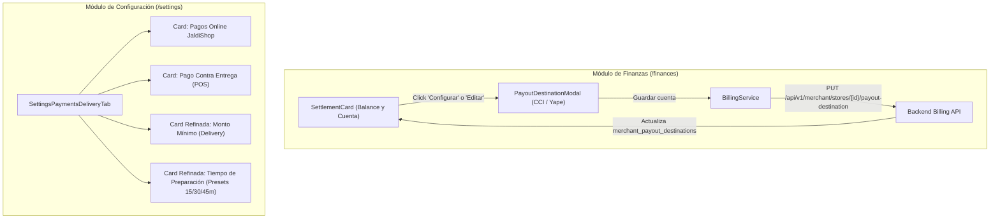

# Plan de Mejora: Cuenta de Abono en Finanzas, Rediseño de Reglas de Despacho y Auditoría de Redundancias

> **Para trabajadores agenticos:** SUB-SKILL REQUERIDO: Usar `superpowers:subagent-driven-development` o `superpowers:executing-plans` para implementar este plan tarea por tarea. Cada paso usa la sintaxis de checklist (`- [ ]`) para seguimiento.

**Meta:** 
1. Resolver la configuración de la "Cuenta de Abono para Liquidaciones" directamente en Finanzas (`/finances`) mediante un modal dedicado e interactivo conectado a `BillingService.updatePayoutDestination()`, eliminando el enlace que rebotaba a `/settings`.
2. Rediseñar visualmente la sección de "Reglas de Compra y Despacho" en `/settings` bajo las pautas de `DESIGN.md` (Impeccable: Dark/Teal, tarjetas con profundidad y jerarquía, inputs monetarios con tipografía tabular y preview en tiempo real).
3. Conducir una auditoría de redundancias en la configuración de la tienda y liquidaciones, eliminando duplicidades y elementos sin utilidad operativa.

---

## 1. Diagnóstico del Problema

### A. Cuenta de Abono Desconectada
- **Comportamiento Actual**: En `Finances` (`settlement-card.html`), al pulsar "Configurar" o "Editar", el botón ejecuta `navigateToSettings()`, redirigiendo a `/settings?tab=payments`. En `/settings` ya no existe el formulario de la cuenta de abono (había sido purgado para desacoplar el cobro al cliente de los payouts). Como resultado, el comercio llega a `/settings` y no encuentra dónde ingresar su CCI o número de Yape.
- **Solución Óptima**: La gestión de la cuenta de abono pertenece naturalmente al dominio de **Finanzas y Liquidaciones**. Implementaremos el componente `PayoutDestinationModal` (`app-payout-destination-modal`) embebido directamente en `/finances`. Cuando el comercio pulse "Configurar" o "Editar", se abrirá el modal para ingresar o modificar su CCI o Yape sin abandonar la pantalla financiera.

### B. Diseño de Reglas de Compra y Despacho en `/settings`
- **Diagnóstico Actual**: El bloque actual de "Reglas de Compra y Despacho" tiene un diseño plano con campos juntos que no comunican con claridad el impacto en el checkout del cliente.
- **Mejora Impeccable**:
  - Separar en 2 cards modulares con micro-interacciones:
    1. **Monto Mínimo de Pedido**: Switch interactivo, input con prefijo monetario estilizado `S/`, mensaje explicativo de cómo impacta al carrito de delivery vs. recojo en tienda, y tag visual "Opcional".
    2. **Tiempo Promedio de Preparación**: Stepper o selector rápido de minutos (15 min, 30 min, 45 min, 60 min, o personalizado) con indicador visual del ritmo operativo y texto aclaratorio de que se muestra al comprador en el estado de orden.

### C. Evaluación y Auditoría de Redundancias
- **Análisis de Utilidad**:
  - *Notas de Auditoría en Admin*: Existen notas internas en el panel de soporte y administración (`admin-store-drawer`), las cuales son de uso exclusivo del personal de plataforma para auditorías de cumplimiento. No impactan al comerciante.
  - *Redundancias en el Merchant*:
    - **Pausa Rápida de Tienda**: Se encontraba duplicada en `/settings` y en `/store`. Se mantiene únicamente en `/store` y en la cabecera operativa.
    - **Moneda y Zona Horaria**: Mostrar tarjetas estáticas no editables de "Soles (PEN)" y "America/Lima" en Settings generaba ruido cognitivo innecesario; se mantienen en segundo plano a nivel de API.
    - **Campos de Transferencia Bancaria Manual**: Al cobrar JaldiShop de forma automática, los campos de número de cuenta para cobro manual son obsoletos y generaban desconfianza en el cliente. Han sido totalmente erradicados.

---

## 2. Mermaid Diagram: Flujo de Cuenta de Abono (Finanzas) y Settings

---

## 3. Plan de Tareas Detallado

### Tarea 1: Componente `PayoutDestinationModal` en Finanzas
- [ ] Crear `payout-destination-modal.ts`, `payout-destination-modal.html` y `payout-destination-modal.css` con soporte para CCI y Yape/Plin.
- [ ] Conectar el modal a `BillingService.updatePayoutDestination()`.
- [ ] Modificar `finances.ts` y `finances.html` para abrir el modal al hacer clic en "Configurar" o "Editar".
- [ ] Crear prueba unitaria `payout-destination-modal.spec.ts`.

### Tarea 2: Rediseño Impeccable de "Reglas de Compra y Despacho" en `/settings`
- [ ] Diseñar 2 tarjetas modulares en `settings-payments-delivery-tab.html`: Monto Mínimo (con presets S/ 15, S/ 20, S/ 30) y Tiempo de Preparación (con presets 15m, 30m, 45m, 60m).
- [ ] Añadir métodos y signals de ayuda en `settings-payments-delivery-tab.ts`.
- [ ] Actualizar y pasar pruebas en `settings-payments-delivery-tab.spec.ts`.

### Tarea 3: Verificación, Tests y Detector Impeccable
- [ ] Ejecutar suite completa de tests de finanzas y settings con Vitest.
- [ ] Validar compilación con `npm run build`.
- [ ] Ejecutar detector Impeccable (`impeccable detect`).
- [ ] Actualizar walkthrough final.
